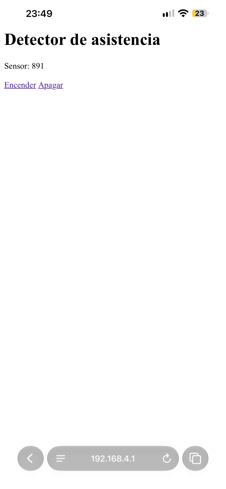

# Página web de la XIAO

Red de la XIAO: `Detector-Asistencia`
Dirección: `192.168.4.1`
Sensor: todavía no está conectado. El valor que se ve es lectura sin sensor en el pin A0.

## Captura


## Código
```cpp
#include <WiFi.h>
#include <WebServer.h>

WebServer server(80);
const int SENSOR = A0;
const int SALIDA = LED_BUILTIN;   
const int ENCENDIDO = LOW;        
const int APAGADO = HIGH;

void handleRoot() {
  int v = analogRead(SENSOR);
  String html = "<html><head>"
    "<meta name='viewport' content='width=device-width'>"
    "<meta http-equiv='refresh' content='2'>"
    "</head><body><h1>Detector de asistencia</h1>"
    "<p>Sensor: " + String(v) + "</p>"
    "<p><a href='/on'>Encender</a> <a href='/off'>Apagar</a></p>"
    "</body></html>";
  server.send(200, "text/html", html);
}

void setup() {
  Serial.begin(115200);
  pinMode(SALIDA, OUTPUT);
  digitalWrite(SALIDA, APAGADO);

  WiFi.softAP("Detector-Asistencia", "12345678");
  Serial.println(WiFi.softAPIP());

  server.on("/", handleRoot);
  server.on("/on", []() {
    digitalWrite(SALIDA, ENCENDIDO);
    server.sendHeader("Location", "/");
    server.send(303);
  });
  server.on("/off", []() {
    digitalWrite(SALIDA, APAGADO);
    server.sendHeader("Location", "/");
    server.send(303);
  });
  server.begin();
}

void loop() {
  server.handleClient();
}```

El código también está en el archivo `pagina-web.ino` de esta carpeta.

## Reto: encender y apagar desde el celular
La página tiene dos enlaces, Encender y Apagar, que prenden y apagan el LED de la propia placa XIAO. No usé un pin externo, solo el LED integrado.

[Video del LED](reto-led.mov)

